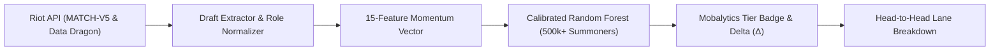

# League Draft Predictor ⚔️
### Calibrated Machine Learning & Live Riot API Draft Analysis Engine

[](https://github.com/Enzozozozo/league-draft-predictor/actions)
[](https://www.python.org/downloads/)
[](https://opensource.org/licenses/MIT)

An end-to-end League of Legends draft advantage predictor inspired by platforms like **Mobalytics** and **Blitz.gg**. 

It takes raw champion select drafts (all 10 picks, bans, keystones, and lane roles) directly from the official **Riot Games API (`MATCH-V5`)**, reconstructs a 15-feature draft momentum vector, and runs it through an **Isotonically Calibrated Random Forest** to output win probabilities and Mobalytics-style draft tier badges.

---

## 💡 Why I Built This

If you play League of Legends, you know the feeling of looking at champion select and immediately thinking, *"This draft is doomed"* or *"We out-scale them everywhere."* 

Apps like Mobalytics give you badges like **`[Heavy Advantage]`** or **`[Skill Match]`**, but I wanted to understand how that actually works mathematically under the hood. Does having a team with a 52% average win rate actually translate into a 52% chance to win? How much does pick order and blind-picking a solo lane matter compared to flat champion strength?

To answer this, I took a dataset of over **500,000 matches**, built a leak-free training pipeline, calibrated the outputs, and connected it directly to the live Riot Games API to test it on real, recent games.

---

## ⚙️ How It Works (Architecture)



### The Mobalytics Tier System
The engine compares the target player's predicted win probability against the neutral 50.0% baseline ($\Delta = \text{Win Prob} - 0.50$):

| Win Prob Delta ($\Delta$) | Mobalytics Badge | Tactical Meaning |
| :--- | :--- | :--- |
| **$\ge +4.0\%$** | `[Heavy Advantage]` | Strong draft synergy; lanes have statistical priority |
| **$+1.5\%$ to $+3.9\%$** | `[Slight Advantage]` | Favorable matchups with slight macro edge |
| **$-1.4\%$ to $+1.4\%$** | `[Even / Skill Match]` | Balanced compositions; outcome determined by in-game execution |
| **$-1.5\%$ to $-3.9\%$** | `[Slight Disadvantage]` | Difficult lane dynamics or lower scaling ceiling |
| **$\le -4.0\%$** | `[Heavy Disadvantage]` | Severely out-drafted; high vulnerability to enemy counters |

---

## 🧠 The Engineering Challenges (The Stuff That Tripped Me Up)

Building this wasn't just throwing data into `RandomForestClassifier()`. Three specific problems shaped this project:

### 1. The Multiplayer "Group Leakage" Trap
In 1v1 sports or tabular ML, standard `train_test_split(test_size=0.2)` works fine. In League of Legends, **it completely breaks your model**.
* In a 5v5 match, 10 players share the exact same match outcome.
* If 6 players from match `EUW1_123` end up in your training set and 4 end up in your test set, your model doesn't learn draft dynamics—it just memorizes the match outcome from the training partition.
* **The Fix**: I used **`GroupShuffleSplit` on `MatchFk`**, strictly ensuring that all 10 players from any match stay together. If a match is in the test set, the model has never seen a single summoner from that game. All historical win rates (champion, keystone, summoner spell) were calculated *exclusively* on the training fold.

### 2. The "Pick Order vs. Role Allotments" Discovery
In the raw database tables (`TeamMatchTbl`), columns were labeled `B1Champ` through `B5Champ` and `R1Champ` through `R5Champ`. At first glance, you might assume:
* $B1$ = Blue 1st Pick, $R1/R2$ = Red Opening Picks, $R5$ = Red Counter-Pick.

When I dug into the champion frequencies, I discovered something completely different:
* Position 1 was **Top** laners (Aatrox, Sett, Fiora).
* Position 2 was **Junglers** (Jarvan IV, Viego, Lee Sin).
* Position 3 was **Mid** laners (Syndra, LeBlanc, Yasuo).
* Position 4 was **Bot/ADC** (Kai'Sa, Jinx, Caitlyn).
* Position 5 was **Support** (Thresh, Nami, Nautilus).

The columns weren't chronological pick turns—they were **Role Allotments**! This meant the formula wasn't comparing pick phases; it was comparing Top lane to Jungle, or Mid to Support. In the live API pipeline, I reworked this so that:
1. Champions are mapped by their true `teamPosition` (matching Top-vs-Top, Jungle-vs-Jungle, etc.).
2. The model accounts for real draft meta: blind-picking volatile solo lanes in early phases incurs counter vulnerabilities, while holding $R5$ preserves the solo-lane counterpick.

### 3. Why Raw Random Forests Lie (Probability Calibration)
Random forests make predictions by averaging hundreds of decision trees. Because bagging averages many binary votes, extreme predictions get diluted toward the center. A raw random forest might output $51.2\%$ for a game that actually has a $58\%$ empirical win rate.
* **The Fix**: I wrapped the model in **Isotonic Regression calibration** (`MonotonicCalibratedForest`). Using a holdout calibration split of unseen matches, the calibrator maps the forest's raw votes back to true real-world win rates across all draft tiers.

---

## 🔍 The Reality Check: A 10-Game Case Study

I tested the pipeline on 10 consecutive ranked games from summoner `Dinozo#3141` (`sea` region). 

The model achieved solid predictions on balanced games, but **Match #6 (`SG2_168483294`)** stood out as a fascinating failure case:

```text
Player: Dinozo#3141 playing Nunu (Jungle) on Red Team
Model Prediction: 56.5% Win Probability (+6.5% [Heavy Advantage])
Actual Match Result: LOSS
```

### Why did the model favor Red by +6.5%?
Looking purely at the training dataset's base win rates, 4 out of 5 Red champions had statistical advantages:
* **Nunu (Red Jungle)**: 51.2% base WR vs. **Rengar (Blue Jungle)**: 45.4% base WR (+5.8% edge)
* **Garen (Red Top)**: 51.0% base WR vs. **Ryze (Blue Top)**: 50.1% base WR
* **Seraphine (Red Support)**: 51.2% base WR vs. **Katarina (Blue Support)**: 48.1% base WR

### Why did Red get crushed in the actual game?
Because flat win rates completely miss **tactical kit interactions**:
1. **Annie's Point-and-Click Stun**: Nunu's entire kit relies on channeled abilities—rolling his snowball ($W$) and channeling Absolute Zero ($R$). Annie's passive stun instantly cancels both on reaction with zero counterplay.
2. **Rengar into Zero Peel**: Blue's Rengar (historically lower average solo-queue win rate due to mechanical difficulty) was drafted into an immobile **Twitch + Seraphine** bot lane with zero hard peel. Rengar farmed kills on repeat.
3. **Katarina Resets**: Katarina support played as a secondary assassin, cleaning up resets whenever Nunu was stopped.

> **Takeaway**: A statistical draft edge ($\pm 6\%$) provides a measurable macro foundation, but specific tactical counters and in-game mechanical execution can completely override flat win-rate priors.

---

## 📁 Repository Structure

```text
league-draft-predictor/
├── .github/workflows/ci.yml       # GitHub Actions automated test suite
├── .gitignore                     # Ignores local keys, caches, and raw data
├── .env.example                   # Template for your Riot API key
├── LICENSE                        # MIT License
├── README.md                      # Project documentation and findings
├── requirements.txt               # Pinned dependencies
│
├── models/
│   └── league_mobalytics_clone.joblib   # Trained & calibrated pipeline (2.47 MB)
│
├── notebooks/
│   ├── 01_model_training_and_calibration.ipynb  # Zero-leakage training & feature engineering
│   └── 02_live_riot_api_evaluation.ipynb        # MATCH-V5 multi-game evaluation on live accounts
│
├── src/                           # Clean modular application package
│   ├── __init__.py
│   ├── riot_client.py             # Riot API wrapper (Account-v1 & Match-v5 routing)
│   ├── draft_extractor.py         # Objective pick/ban parsing & role assignment
│   ├── champion_data.py           # Data Dragon catalog synchronization
│   ├── ai_model.py                # Pipeline inference & Mobalytics Tier Badge logic
│   ├── config.py                  # Environment config and fallback paths
│   ├── schemas.py                 # Dataclasses & types
│   └── app.py                     # CLI entrypoint
│
└── tests/                         # 13 Unit tests (all passing)
    ├── test_ai_model.py
    ├── test_draft_extractor.py
    └── test_riot_client.py
```

---

## 🚀 Quickstart

### 1. Clone & Install
```bash
git clone https://github.com/Enzozozozo/league-draft-predictor.git
cd league-draft-predictor
pip install -r requirements.txt
```

### 2. Run the Test Suite
Verify that all unit tests pass locally:
```bash
python -m unittest discover tests
```

### 3. Run in Offline / Mock Mode (Zero Setup Required)
You can run a full draft analysis immediately without needing a Riot API key:
```bash
python -m src.app
```

### 4. Run Live on Your Own Riot Account
1. Get a free developer API key from [developer.riotgames.com](https://developer.riotgames.com/).
2. Create a `.env` file:
   ```bash
   RIOT_API_KEY=RGAPI-your-key-here
   RIOT_REGION=sea
   RIOT_PLATFORM=sg2
   ```
3. Run the live evaluation:
   ```bash
   python -m src.app --player "YourGameName#Tag" --region sea
   ```
   Or open `notebooks/02_live_riot_api_evaluation.ipynb` in Jupyter to inspect your latest 10 matches interactively.

---

## 📜 License
Distributed under the MIT License. See [LICENSE](LICENSE) for details.

*Disclaimer: This project is not endorsed by Riot Games and does not reflect the views or opinions of Riot Games or anyone officially involved in producing or managing Riot Games properties.*
